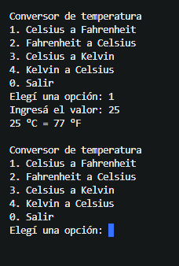

# Conversor de temperatura

Programa de consola en C# que convierte temperaturas entre Celsius, Fahrenheit y Kelvin.



## Funcionalidades
- Menú interactivo que se repite hasta elegir salir
- Conversiones: °C ↔ °F y °C ↔ K
- Validación de opciones y valores ingresados

## Tecnologías
- C#
- .NET (consola)

## Cómo correrlo
1. Instalar el [.NET SDK](https://dotnet.microsoft.com/download)
2. Clonar el repositorio:
```
   git clone https://github.com/degregoriomauro-tech/temp_converter.git
```
3. Entrar a la carpeta y ejecutar:
```
   dotnet run
```

## Qué practiqué
Bucles, condicionales, `switch`, `TryParse` y manejo de entradas inválidas.

## Autor
Mauro De Gregorio, [GitHub](https://github.com/degregoriomauro-tech)  
